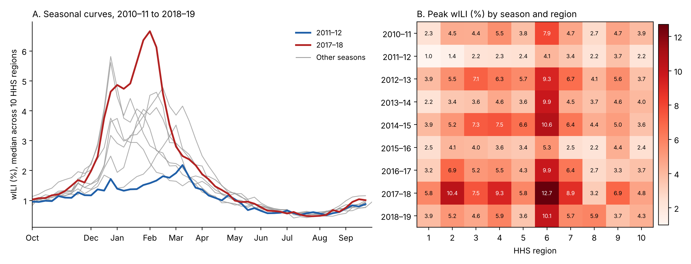

# Regional influenza-like illness forecasting

BIOSTAT 707 • Final report • Integrated evidence from v0.1–v0.5 • 17 November 2026

Bowen (Bofan) Zhang • Yufei Wang • Leslie (Jiaxiang) Xue • Lanbu Xi • Michael (Shuyang) Yu

## Abstract

We forecast CDC ILINet population-weighted influenza-like illness (wILI) two observation weeks ahead in ten US HHS regions using the preceding 12 weeks, region indicators, and calendar features. A two-season pilot was extended, following instructor feedback, to six-season rolling-origin evaluation, frozen-forecast diagnostics, residual-based probability forecasts, and a historical-vintage backtest. This report synthesizes saved results; it adds no model experiments.

The pilot favored Ridge (test Macro-MAE 0.417, 14.9% below persistence). Across six rolling test seasons, histogram gradient boosting (HGB) had the lowest Macro-MAE (0.320; 20.6% below persistence) and weighted interval score (WIS 0.238; 18.6% below persistence), whereas Ridge had the lowest RMSE (0.618). In a matched historical-vintage comparison, AsOf WIS increased relative to revised data by 9.5% for Ridge, 10.6% for HGB, and 12.1% for LSTM. Ridge had the lowest WIS in both matched regimes. Rankings therefore depend on loss function, evaluation sample, and information availability.

The evidence supports simple regularized and tree-based methods as useful benchmarks, but does not establish a universal winner. Six historical seasons, dependent observations, incomplete vintage coverage, and retrospective design choices limit generalization. Overall interval coverage also concealed undercoverage during the severe 2017–18 season.

## How the instructor’s recommendations were addressed

| Stage | Question and completed response |
| --- | --- |
| v0.1 • Pilot | Persistence, Ridge, HGB, and a small LSTM; original results frozen. |
| v0.2 • Rolling evaluation | Six outer test seasons; expanded Ridge grid; seasonal baseline. |
| v0.3 • Diagnostics | Region/season summaries, paired block bootstrap, isotonic CORP diagnostics. |
| v0.4 • Probabilities | 23 residual-based quantiles; WIS, coverage, and uncertainty comparisons. |
| v0.5 • Vintage | Historical release-date cutoffs; matched revised-data comparison. |

Each stage retains its own protocol, forecasts, and outputs. Results from different samples are not pooled into one score.

# Data, models, and chronological evaluation

The source is CDC ILINet wILI, obtained through the CMU Delphi API [1,2], for epidemiological weeks 2010w40–2019w39: 4,690 region-week observations across ten HHS regions. wILI is the population-weighted percentage of outpatient visits meeting the ILI definition; it is neither infection prevalence nor laboratory-confirmed influenza incidence.

Each forecast uses 12 consecutive wILI observations ending at origin t, a region indicator, and sine/cosine calendar features for the target week t+2. Models pool regions. No weather, virological, mobility, or other external covariates are included. Scaling is fitted only on the relevant training observations. Evaluation retains valid windows and prevents origin/target pairs from crossing the specified split boundaries.

| Model | Role and configuration |
| --- | --- |
| Persistence | Forecast equals the latest observed regional wILI. |
| Seasonal | Mean for the same week in earlier seasons, within region; week 53 uses the documented week 52/1 fallback. |
| Ridge | Regularized linear regression on lag, region, and calendar features. |
| HGB | Histogram gradient boosting: 100 iterations, learning rate 0.05, 7 leaves, minimum leaf size 20, L2=1; no early stopping. |
| LSTM | Small recurrent network, hidden size 16; maximum 60 epochs, validation-selected epoch; one seed (2026). |

Limited model configurations were retained. The seasonal comparator was added in v0.2.

Pilot: six training seasons (2010–11 through 2015–16), validation 2016–17, and test 2017–18 plus 2018–19. There were 3,000 training, 500 validation, and 1,020 test windows. The pilot did not refit on training plus validation.

Rolling evaluation: six outer test seasons, 2013–14 through 2018–19. For each test season, fit candidate models on seasons before the immediately preceding validation season; select on that validation season; then refit using all pre-test seasons. There are 3,010 test region-windows per model. This is chronological retrospective evaluation, not six newly collected prospective seasons: some earlier years had already been used in the pilot.

The expanded Ridge grid was {0.1, 1, 10, 100, 1,000, 10,000, 100,000}. Selected values by outer season were 10, 1, 10, 100, 100, and 0.1. None exceeded 100, so the pilot’s boundary choice did not imply that stronger penalties would improve later evaluations. Final LSTM refit epochs were 56, 38, 36, 11, 21, and 27.

## Exploratory analysis

Figure 1 summarizes the series before modeling. wILI is strongly seasonal. Across all 4,690 region-weeks the median is 1.30% (interquartile range 0.76–2.20%), and the off-season mean (MMWR weeks 20–39) is 0.84%. Of the 90 region-season peaks, 98% fall between mid-December and late March, and the median peak is in early February (MMWR week 6). Peak timing still shifts by several weeks between seasons, from late December (2012–13, 2014–15) to early March (2011–12, 2015–16).

Severity varies more than timing. The median regional peak ranged from 2.25% in 2011–12, the mildest season, to 7.23% in 2017–18, the most severe and higher than any earlier season. Region 6 had the highest peak in every season (mean 3.05%; 12.71% in 2017–18), whereas Regions 1, 8, and 10 had means between 1.0% and 1.2%.

These features shaped the design. Within each region, the correlation between wILI and its value two weeks earlier was 0.85–0.91, so persistence is a strong baseline and recent lags carry most of the signal. Regions move together (median pairwise correlation 0.83, minimum 0.71), so region-weeks are not independent observations; this is why regions are pooled in one model and the block bootstrap below resamples whole weeks with all ten regions. A fixed same-week seasonal mean cannot follow shifting peak timing, which anticipates its weak performance in Table 2. Finally, 2017–18 lies above the range of all earlier training seasons, which anticipates the interval undercoverage reported for that season.

Figure 1. Exploratory summary of the committed ILINet snapshot, 2010w40–2019w39. A: weekly median wILI across the ten HHS regions, by season; the mildest (2011–12) and most severe (2017–18) seasons are highlighted. B: peak weekly wILI for each season and region. Produced by scripts/eda_missingness.py from data/normalized.csv; summary values are in outputs/eda/eda_summary.json.

## Missing data and data quality

The modeling snapshot has no missing outcome values. All ten regions have 469 consecutive weekly observations from 2010w40 to 2019w39 (4,690 of 4,690 expected region-weeks), with 7-day spacing, no duplicate region-weeks, and no zero or negative wILI. Season 2014–15 contains MMWR week 53, which is a calendar feature, not a gap. The loader (src/data.py) checks for this complete panel and stops with an error if a week is missing, duplicated, or non-finite, instead of imputing. No imputation was therefore performed in v0.1–v0.4. One unused API field (num_age_2, an age-group count) is blank in every row; the models use only wILI.

This completeness partly reflects the snapshot itself. It holds finalized values issued 52 to 365 weeks after each epidemiological week (issues 2017w40–2020w39), after reporting backfill had settled. Values available in real time were provisional and could be absent. The historical-vintage analysis (v0.5) addresses this directly. When a historical snapshot lacked a needed 12-week history, label, or seasonal reference value, the window was excluded from both the AsOf and MatchedRevised regimes rather than filled with revised values, because filling them would leak later information into earlier forecasts. Eligibility was 40% of test windows in 2013–14 and 92–96% in later seasons (2,540 of 3,010 overall). Because exclusions cluster in the earliest season, the vintage comparison describes a different population from the full rolling evaluation, and the excluded windows may not be missing at random with respect to forecast difficulty.

# Point forecasts: the winner depends on the loss

| Model | Pilot MAE | Pilot RMSE |
| --- | --- | --- |
| Persistence | 0.490 | 0.850 |
| Ridge | 0.417 | 0.778 |
| HGB | 0.431 | 0.912 |
| LSTM | 0.436 | 0.848 |

Table 1. Pilot test, two seasons, n=1,020 per model. MAE is region-macro MAE; RMSE is pooled. Units: percentage points (pp).

Ridge reduced pilot MAE by 14.9% relative to persistence, ahead of HGB and LSTM. HGB won on validation MAE but not test MAE. This is compatible with season-to-season distribution changes and selection variability; it is not evidence that validation selection was improper.

| Model | Rolling MAE | Rolling RMSE | Bias |
| --- | --- | --- | --- |
| Persistence | 0.403 | 0.705 | 0.004 |
| Seasonal | 0.529 | 0.962 | -0.242 |
| Ridge | 0.339 | 0.618 | -0.073 |
| HGB | 0.320 | 0.623 | -0.071 |
| LSTM | 0.336 | 0.630 | -0.073 |

Table 2. Six-season rolling test, n=3,010 per model. Bias = prediction − observation; negative means underprediction. All values in pp.

HGB reduced rolling MAE by 20.6%, Ridge by 15.8%, and LSTM by 16.6% versus persistence. HGB had the lowest MAE, while Ridge had the lowest RMSE. The simple same-week seasonal mean was worse than persistence; this is evidence against this specific baseline, not against all seasonal forecasting methods.

## Interpreting Ridge, LSTM, and the MAE–RMSE tradeoff

Ridge can exploit strong lag relationships while shrinking correlated coefficients. Its low variance is plausibly useful for a small, temporally dependent training set. A small LSTM has more estimation and optimization demands, and these data may not reward additional flexibility. These are explanations consistent with the results, not causal findings from an ablation study. LSTM slightly surpassed Ridge on rolling MAE, but not on rolling RMSE or WIS; the pilot does not show that LSTMs generally fail.

In the pilot, HGB improved MAE (0.431 versus 0.490) but worsened RMSE (0.912 versus 0.850) relative to persistence. Average absolute error fell while squared error rose: the aggregate benefit was outweighed, under squared loss, by larger errors. This does not by itself identify which weeks caused the errors. In the rolling study HGB improved both scores versus persistence, but its RMSE remained slightly above Ridge’s (0.623 versus 0.618).

# Dependence-aware uncertainty and mean calibration

The paired moving-block bootstrap [3] resamples contiguous weekly blocks within each of the six fixed test seasons. Every sampled week retains all ten regions and all models, preserving pairing and contemporaneous dependence. The primary analysis uses 5,000 replicates and block length 8; lengths 4 and 13 are sensitivity checks. Overlapping, noncircular blocks are concatenated and truncated to each original season length. Differences below are model minus persistence.

| Model | Δ MAE [95% interval] | Δ RMSE [95% interval] |
| --- | --- | --- |
| Seasonal | 0.126 [0.056, 0.234] | 0.258 [0.086, 0.471] |
| Ridge | -0.063 [-0.110, -0.041] | -0.087 [-0.164, -0.034] |
| HGB | -0.083 [-0.142, -0.042] | -0.082 [-0.226, 0.050] |
| LSTM | -0.067 [-0.115, -0.040] | -0.075 [-0.168, 0.001] |

Table 3. Conditional percentile bootstrap intervals, primary block length 8; units pp. No multiplicity adjustment.

All three learned models have MAE-difference intervals below zero. Only Ridge has a primary RMSE interval entirely below zero. LSTM’s RMSE interval includes zero for block lengths 4 and 8 but excludes zero for 13; its conclusion is sensitive to block length. These intervals condition on the observed seasons, fitted models, and protocols. They do not include model-training uncertainty or establish future-season rankings. Nonstationary within-season behavior and unequal endpoint inclusion also limit bootstrap interpretation.

## CORP decomposition for continuous mean forecasts

Following Gneiting and Resin [4], increasing isotonic regression gives a diagnostic recalibration of the saved forecasts. With S = original MSE and Siso = isotonic MSE, miscalibration MCB = S − Siso, discrimination DSC = UNC − Siso, and uncertainty UNC = Var(y). Thus S = MCB − DSC + UNC. This decomposes squared error, not MAE or RMSE; discrimination here is not classification AUROC.

| Model | MSE | MCB ↓ | DSC ↑ |
| --- | --- | --- | --- |
| Persistence | 0.497 | 0.069 | 2.114 |
| Seasonal | 0.926 | 0.148 | 1.763 |
| Ridge | 0.381 | 0.052 | 2.212 |
| HGB | 0.388 | 0.082 | 2.236 |
| LSTM | 0.397 | 0.075 | 2.219 |

Table 4. Pooled empirical mean-calibration decomposition, n=3,010. UNC=2.542 for every model. Units: squared pp.

Ridge has the smallest empirical MCB; HGB has the largest DSC. Compared with Ridge, HGB gains 0.024 in discrimination but incurs 0.030 more miscalibration, leaving MSE 0.006 higher. This is descriptive score accounting, not an algorithmic causal explanation. Same-sample isotonic fitting can be optimistic. Reliability curves are diagnostic only and were not used to replace test predictions. Near-zero average bias, as for persistence, does not establish conditional calibration.

# Probability forecasts: WIS and coverage

Each model’s saved point forecasts were augmented with empirical residual quantiles from the immediately preceding validation season. Residuals equal observed minus predicted wILI, pooled across regions. For each of 23 quantile levels, the corresponding residual quantile is added to the final-refit point forecast and clipped to [0,100]. The distribution is frozen before the outer test season. No new point-model fitting or hyperparameter search was introduced in v0.4.

Quantile levels are 0.01, 0.025, 0.05, 0.10, …, 0.95, 0.975, and 0.99. They define a median and 11 central intervals. For interval [l,u] with nominal coverage 1−α, ISα = (u−l) + (2/α)(l−y)+ + (2/α)(y−u)+. Here (z)+ = max(z,0). WIS = {0.5|y−m| + Σ(α/2)ISα}/11.5, equivalently twice the average pinball loss over all 23 quantiles [5]. Lower WIS rewards narrower intervals while penalizing misses; good WIS alone does not establish calibration.

| Model | WIS ↓ | Reduction vs persistence | 95% coverage |
| --- | --- | --- | --- |
| Persistence | 0.293 | 0.0% | 93.9% |
| Seasonal | 0.389 | -33.1% | 91.3% |
| Ridge | 0.247 | 15.7% | 93.8% |
| HGB | 0.238 | 18.6% | 94.1% |
| LSTM | 0.249 | 15.0% | 92.5% |

Table 5. Six-season rolling probability forecasts, n=3,010 per model. WIS in pp. Coverage is empirical, not a confidence level for model comparisons.

HGB had the lowest WIS, 18.6% below persistence. Primary paired-block intervals for WIS differences were −0.046 [−0.077, −0.028] for Ridge, −0.054 [−0.099, −0.019] for HGB, and −0.044 [−0.078, −0.020] for LSTM. All three remained below zero in the block-length sensitivity checks, conditional on the fitted distributions and observed seasons.

HGB’s overall 95% interval coverage was 94.1%, but coverage fell to 87.6% in 2017–18. Aggregate coverage can therefore conceal difficulty in a severe season. Region- and season-specific tables and coverage figures remain in the archived v0.4 outputs.

## Limits of residual-based distributions

The same validation season selected model settings and estimated residual quantiles, so it is not an independent calibration sample. Validation residuals come from a model trained on less history than the final-refit model. Pooling assumes transferable errors across regions and epidemic phases; it does not model changing variance or tail behavior. Tail quantiles rely on relatively few dependent observations. The predictive median can differ from the original point forecast, so median MAE/RMSE in probability files should not be substituted for the original point-model scores. Direct quantile boosting was not required or run; the instructor’s residual-quantile alternative was used.

# Historical vintages: what was known at issuance?

The v0.5 backtest downloaded 212,710 historical records through Delphi [1,2]. For a specified cutoff, it selected the latest release_date not exceeding that cutoff, breaking ties by the highest issue value. Late backfills were not allowed into earlier information sets. The archive supplies dates rather than a fully verified intraday dissemination history; this is an archive-based real-time approximation.

## Forecast horizon and cutoffs

Let the origin week end on Saturday t. Issuance is scheduled at t+7 days, and the target week ends at t+14 days. This preserves the t+2 observation-week target but leaves only seven days from scheduled issuance to target week end. It must not be described as a 14-day forecast after actual publication.

For each outer fold, model-selection training uses the snapshot available at the first scheduled issuance of the validation season. Validation features use their own issuance-date snapshots; validation labels are available by the outer test fit cutoff. Final refitting and residual-quantile fitting occur at the first scheduled test issuance, then remain fixed through the season. Historical training features may use revisions already known by their fit cutoff. Test labels are excluded from fitting.

| Regime | Purpose |
| --- | --- |
| AsOf | Features and fitting labels restricted to the relevant historical cutoffs. |
| MatchedRevised | Fresh revised-data pipeline using exactly the same eligible train/validation/refit/test IDs and reference keys as AsOf. |
| OriginalFrozen | Earlier v0.2/v0.4 forecasts restricted to eligible targets; contextual comparison only. |

The controlled comparison is AsOf versus MatchedRevised. OriginalFrozen has different training eligibility and is not an equivalent control.

AsOf and MatchedRevised share sample identifiers, scaler-observation IDs, seasonal reference keys, model rules, and seed/grid. Their data values, labels, fitted scaling, selected settings, and fitted parameters can differ. The contrast estimates the combined pipeline sensitivity to information availability; it does not isolate a fixed model’s sensitivity to input revisions.

## Incomplete vintage availability

There are 2,540 common test region-windows per model, 84.4% of the original 3,010. Eligible origin-week counts by season are 20, 47, 46, 48, 46, and 47, each with all ten regions. The first season’s target dates are only 4 January–17 May 2014. Missing histories, labels, or seasonal reference observations cause exclusions in both regimes; revised values were not imputed into missing historical snapshots.

All regimes are scored against the same revised-data reference snapshot frozen on 20 October 2026. This aligns comparisons but does not make the reference immutable ground truth. Restricted availability changes the evaluation population, especially in early seasons; results cannot be generalized to excluded weeks without further evidence.

# Vintage comparison: higher errors, qualified rankings

| Model | Revised WIS | AsOf WIS | Change |
| --- | --- | --- | --- |
| Persistence | 0.3026 | 0.3335 | +10.2% |
| Seasonal | 0.4017 | 0.4031 | +0.4% |
| Ridge | 0.2506 | 0.2744 | +9.5% |
| HGB | 0.2514 | 0.2780 | +10.6% |
| LSTM | 0.2531 | 0.2837 | +12.1% |

Table 6. MatchedRevised versus AsOf, n=2,540 per model in each regime. WIS in pp; change is relative to MatchedRevised.

| Model | Revised MAE | AsOf MAE | Revised RMSE | AsOf RMSE |
| --- | --- | --- | --- | --- |
| Persistence | 0.417 | 0.474 | 0.719 | 0.775 |
| Seasonal | 0.548 | 0.549 | 0.999 | 0.998 |
| Ridge | 0.344 | 0.384 | 0.626 | 0.650 |
| HGB | 0.336 | 0.379 | 0.657 | 0.679 |
| LSTM | 0.342 | 0.391 | 0.641 | 0.685 |

Table 7. Original point-forecast scores on the matched sample; these are not probability-median scores. Units pp.

Historical information increased overall WIS by 9.5% for Ridge, 10.6% for HGB, and 12.1% for LSTM. Ridge had the lowest WIS and RMSE in AsOf; HGB retained the lowest point MAE. These differences are descriptive: no new significance claim is made for the matched-vintage scores.

Ridge also had the lowest WIS in MatchedRevised. Therefore the change from HGB leading the full v0.4 evaluation to Ridge leading v0.5 cannot be attributed solely to historical revisions. The eligible evaluation sample and training masks also changed. Some season-specific AsOf-minus-revised differences were negative, so vintage data did not worsen every model in every season.

AsOf 95% interval coverage was 93.3% for Ridge, 93.7% for HGB, and 91.5% for LSTM. WIS, coverage, and width should be read together rather than treating nominal interval labels as achieved calibration. Full matched region/season summaries and availability diagnostics remain in the archived v0.5 outputs.

The original consecutive-week bootstrap was not reused for the gapped vintage subset: relabeling gaps as adjacent observations would misrepresent serial dependence. The prior interval results apply to their original six-season sample and cannot be attached to the matched vintage differences.

## Interpretation for an applied forecasting workflow

Choose the loss function before comparing models. HGB is attractive for average absolute error; Ridge is a strong parsimonious comparator when large errors and matched-vintage WIS matter. Historical availability should be part of evaluation, not an afterthought. These historical results support benchmark selection and further validation; they do not certify operational public-health deployment.

# Limitations, AI use, and reproducibility

## What the evidence can and cannot support

Six outer seasons offer broader historical coverage than the two-season pilot, but they remain a small and selected set. The severe 2017–18 season materially affects performance. Regional series and neighboring windows are dependent. Model changes followed examination of pilot results; rolling-origin cutoffs limit within-fold leakage but do not erase retrospective researcher adaptation. Future prospective evaluation would be stronger evidence than reusing this historical period.

The study uses one small LSTM configuration and one seed; its results do not compare all neural architectures with all linear or tree methods. The seasonal baseline is deliberately simple. Pooled residual distributions are not conditionally calibrated probability models, and same-sample isotonic diagnostics are not out-of-sample recalibration guarantees. Limited vintage coverage and date-only cutoffs further constrain the real-time interpretation. FluSight-style quantile scoring is relevant, but this historical ILI analysis is not a current FluSight submission or an evaluation of its current hospitalization target [6].

## AI use disclosure

OpenAI Codex assisted with implementation, data retrieval, window construction, model-training workflows, debugging, automated verification, statistical summaries, and drafting reports and presentation materials. AI-generated code performed substantial analytical work; its role was not limited to language editing. The staged workflow expanded the project from a pilot to rolling evaluation, uncertainty diagnostics, probability forecasts, and historical-vintage comparisons while retaining saved forecasts and reproducible artifacts.

Benefits included rapid implementation, consistent output generation, and explicit checks of time cutoffs and artifact preservation. Risks included plausible but incorrect code or interpretation and overconfidence in automated checks. A concrete v0.5 verification issue initially assumed two tables had identical row order; alignment was corrected to sample/model/regime keys and regression checks were added. Review by another AI agent was an additional automated check, not independent human validation.

AI reduced coding and documentation effort, allowing a broader project, but breadth is not evidence of analytical understanding. The team must be able to explain the split logic, WIS penalties, bootstrap conditioning, and vintage horizon in its own words. AI explanations provided material for studying these methods, but individual learning outcomes were not measured and independent verification by every team member is not established. Authors remain responsible for the presented conclusions.

## Reproducibility and preservation

No new experiments were run for this synthesis or repository update. Exact source rows and hashes for the primary tables are saved in reports/source/facts.json; additional WIS bootstrap intervals and vintage date ranges are in outputs/probabilistic_v0_4 and outputs/vintage_v0_5. The repository includes code, data snapshots, fitted models, point and quantile forecasts, regional and seasonal tables, figures, and original verification records. The README gives reproduction and current checkout verification commands. A submission import manifest verifies that the archived scientific files are unchanged. Historical archive-preservation checks additionally depend on the original companion ZIP layout; they are distinguished from verification of this repository.

## Conclusion

The most defensible conclusion is conditional: HGB led on six-season revised-data MAE and WIS, Ridge led on RMSE and matched-vintage WIS, and the small LSTM did not consistently improve on simpler methods. Dependence, severe-season undercoverage, and real-time data revisions are central evaluation issues, not secondary implementation details.

# References and evidence map

[1] CMU Delphi. FluView API documentation. https://cmu-delphi.github.io/delphi-epidata/api/fluview.html

[2] CMU Delphi. FluView ILINet historical signal documentation. https://cmu-delphi.github.io/delphi-epidata/api/v5-signals/fluview_ilinet.html

[3] Künsch, H. R. (1989). The jackknife and the bootstrap for general stationary observations. Annals of Statistics, 17, 1217–1241. https://doi.org/10.1214/aos/1176347265

[4] Gneiting, T., & Resin, J. (2023). Regression diagnostics meets forecast evaluation: conditional calibration, reliability diagrams, and coefficient of determination. Electronic Journal of Statistics, 17, 3226–3286. https://doi.org/10.1214/23-EJS2180

[5] Bracher, J., Ray, E. L., Gneiting, T., & Reich, N. G. (2021). Evaluating epidemic forecasts in an interval format. PLoS Computational Biology, 17, e1008618. https://doi.org/10.1371/journal.pcbi.1008618 (2022 correction: https://doi.org/10.1371/journal.pcbi.1010592).

[6] CDC. FluSight forecast hub: model-output format. https://github.com/cdcepi/FluSight-forecast-hub/blob/main/model-output/README.md

## Traceability of the final tables

| Final table / topic | Original project evidence |
| --- | --- |
| 1 • Pilot | outputs/demo_v0_1/metrics.csv |
| 2 • Rolling | outputs/rolling_v0_2/metrics.csv; model_selection_summary.csv |
| 3 • Paired uncertainty | outputs/diagnostics_v0_3/bootstrap_intervals.csv |
| 4 • CORP | outputs/diagnostics_v0_3/calibration_components.csv |
| 5 • Probability forecasts | outputs/probabilistic_v0_4/metrics.csv; coverage.csv |
| 6–7 • Vintage comparison | outputs/vintage_v0_5/metrics.csv; coverage.csv |
| Vintage availability/cutoffs | outputs/vintage_v0_5/availability_summary.csv; test_date_ranges.csv; protocol_frozen.md |
| Full predictions and plots | Respective version output folders in the repository. |

Paths are relative to the repository root. Tables generally round to three decimals; Table 6 uses four to distinguish close WIS values. Source CSVs retain full precision.

Macro-MAE averages regional MAE with equal region weights. RMSE pools all evaluated prediction errors. Balanced region coverage makes Macro-MAE equal pooled MAE for these overall samples. WIS is averaged within region and then across regions. No accuracy values are averaged across versions with different samples. All scientific claims in this synthesis derive from the saved version outputs and their documented protocols.
